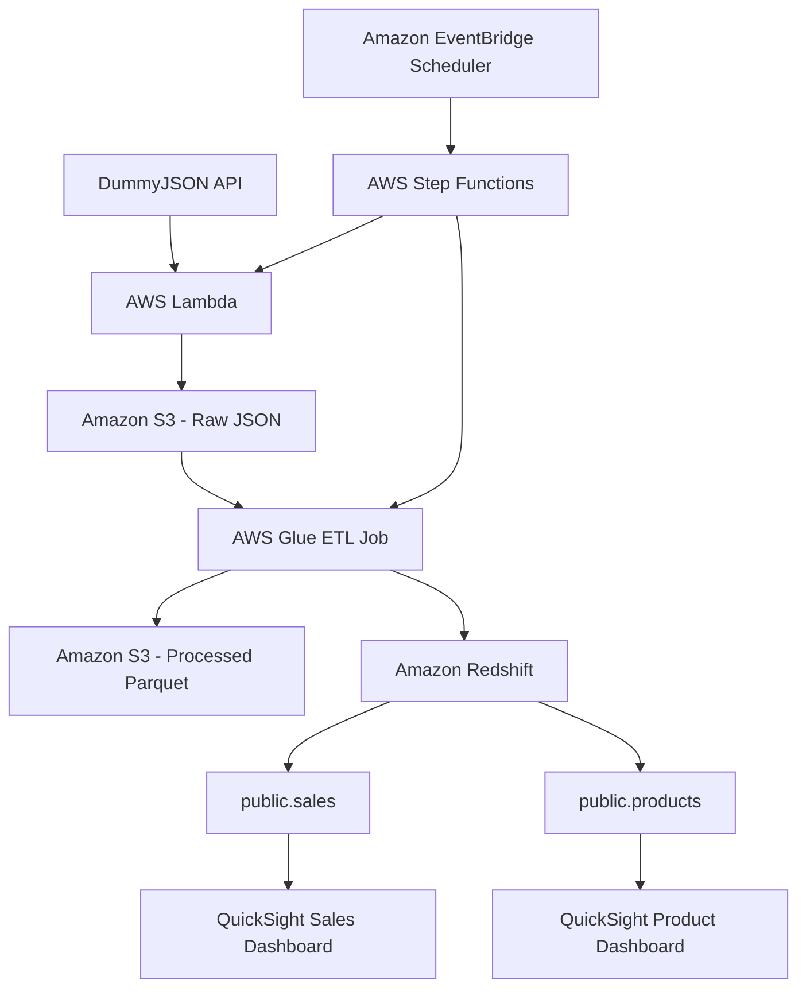

# 🚀 Retail Sales ETL Pipeline Using AWS

## 📌 Project Overview

This project demonstrates an end-to-end ETL (Extract, Transform, Load) pipeline built using AWS services.

AWS Lambda fetches product data from the DummyJSON API and stores the raw JSON data in Amazon S3. AWS Glue processes the data and stores the processed files in Parquet format. AWS Step Functions orchestrates the workflow, while Amazon EventBridge Scheduler triggers the workflow on a schedule.

The processed data is available in Amazon Redshift, where the `public.sales` and `public.products` tables contain data. Amazon QuickSight is used to create Sales and Product dashboards for data visualization.

## 🎯 Project Goal

The goal of this project is to build a cloud-based data pipeline that demonstrates how to:

- Extract data from an external API.
- Store raw and processed data in Amazon S3.
- Transform data using AWS Glue.
- Orchestrate workflows using AWS Step Functions.
- Schedule workflow execution using Amazon EventBridge Scheduler.
- Store analytical data in Amazon Redshift.
- Visualize data using Amazon QuickSight.

## 🏗️ Architecture Diagram

## 🔄 Workflow

### 1. Data Extraction
AWS Lambda calls the DummyJSON API to fetch product data.

### 2. Raw Data Storage
The retrieved JSON data is stored in an Amazon S3 bucket.

### 3. Data Transformation
AWS Glue runs the ETL job to process and transform the data.

### 4. Processed Data Storage
The processed data is stored in Amazon S3 in Parquet format.

### 5. Workflow Orchestration
AWS Step Functions coordinates the pipeline execution. The workflow execution has been tested successfully and shows `Succeeded`.

### 6. Scheduled Execution
Amazon EventBridge Scheduler is configured to trigger the Step Functions state machine on a schedule.

### 7. Data Warehouse
Amazon Redshift stores the data in the `public.sales` and `public.products` tables.

### 8. Data Visualization
Amazon QuickSight provides two dashboards:
- Sales Dashboard
- Product Dashboard

## 🧰 Tech Stack

| Technology | Purpose |
|---|---|
| DummyJSON API | Source of product data |
| AWS Lambda | Fetches API data |
| Amazon S3 | Stores raw JSON and processed Parquet files |
| AWS Glue | Performs ETL processing |
| AWS Step Functions | Orchestrates workflow execution |
| Amazon EventBridge Scheduler | Schedules workflow execution |
| Amazon Redshift | Stores analytical data |
| Amazon QuickSight | Creates interactive dashboards |
| GitHub | Stores and documents the project |

## ✨ Key Features

- Automated API data ingestion using AWS Lambda.
- Raw data storage in JSON format.
- Processed data storage in Parquet format.
- ETL processing using AWS Glue.
- Workflow orchestration using AWS Step Functions.
- Scheduled execution using Amazon EventBridge Scheduler.
- Analytical tables in Amazon Redshift.
- Sales and Product dashboards in Amazon QuickSight.
- Integration of multiple AWS services into a data engineering pipeline.

## 📚 What I Learned

- Integrating external APIs with AWS Lambda.
- Working with Amazon S3 for data storage.
- Understanding raw and processed data formats.
- Creating and running ETL jobs with AWS Glue.
- Orchestrating AWS workflows using Step Functions.
- Scheduling automated workflows using EventBridge Scheduler.
- Working with tables in Amazon Redshift.
- Creating dashboards using Amazon QuickSight.
- Understanding how cloud services work together in an ETL pipeline.

## 💡 Skills Demonstrated

- AWS Cloud Services
- Python and API Integration
- Data Ingestion
- ETL Pipeline Development
- Data Transformation
- Amazon S3 Data Storage
- Workflow Orchestration
- Workflow Scheduling
- Data Warehousing
- SQL and Redshift Tables
- Data Visualization
- Cloud Troubleshooting
- Technical Documentation
- Git and GitHub

## ✅ Project Status

- [x] Lambda fetches product data from DummyJSON.
- [x] Raw JSON data is stored in Amazon S3.
- [x] AWS Glue ETL job runs successfully.
- [x] Processed Parquet files are stored in Amazon S3.
- [x] Amazon Redshift tables are created and contain data.
- [x] Step Functions execution shows `Succeeded`.
- [x] EventBridge Scheduler is configured.
- [x] Sales Dashboard is created in QuickSight.
- [x] Product Dashboard is created in QuickSight.

## 🔐 Security Notes

- Never upload AWS access keys or secret access keys to GitHub.
- Do not commit passwords, database credentials, or private configuration files.
- Review screenshots before publishing them.
- Do not upload sensitive data or unnecessary raw data exports.
- Use environment variables or AWS IAM roles to manage credentials securely.
itHub profile link here.
