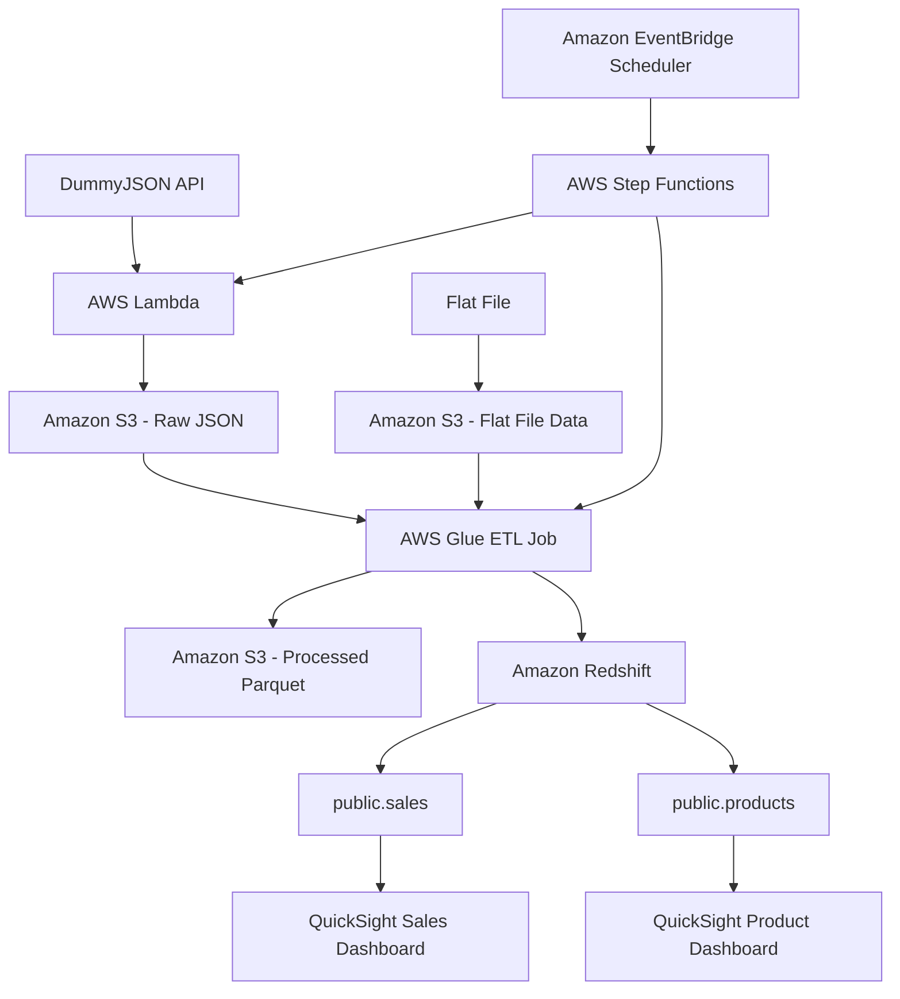

# 🚀 Retail Sales ETL Pipeline Using AWS

## 📌 Project Overview

This project demonstrates an end-to-end ETL (Extract, Transform, Load) pipeline built using AWS services.

The pipeline uses data from two sources: the DummyJSON API and a flat file. AWS Lambda fetches product data from the DummyJSON API and stores the raw JSON data in Amazon S3. The flat file provides an additional data source for the pipeline.

AWS Glue processes and transforms the data, and the processed files are stored in Parquet format in Amazon S3. AWS Step Functions orchestrates the workflow, while Amazon EventBridge Scheduler is configured to trigger the workflow on a schedule.

Amazon Redshift stores the data in the `public.sales` and `public.products` tables. Amazon QuickSight is used to create Sales and Product dashboards for data visualization.

## 🎯 Project Goal

The goal of this project is to build a cloud-based ETL pipeline that demonstrates how to:

- Ingest data from an external API and a flat file.
- Store raw and processed data in Amazon S3.
- Transform data using AWS Glue.
- Orchestrate workflows using AWS Step Functions.
- Schedule workflow execution using Amazon EventBridge Scheduler.
- Store analytical data in Amazon Redshift.
- Visualize data using Amazon QuickSight.

## 🏗️ Architecture Diagram

## 🔄 Workflow

### 1. Data Sources
The pipeline uses the DummyJSON API and a flat file as data sources.

### 2. Data Extraction
AWS Lambda fetches product data from the DummyJSON API.

### 3. Raw Data Storage
The API response is stored as raw JSON in Amazon S3. The flat file is used as an additional source of data.

### 4. Data Transformation
AWS Glue processes and transforms the input data as part of the ETL workflow.

### 5. Processed Data Storage
Processed data is stored in Amazon S3 in Parquet format.

### 6. Workflow Orchestration
AWS Step Functions coordinates the workflow execution.

### 7. Scheduled Execution
Amazon EventBridge Scheduler is configured to trigger the Step Functions state machine on a schedule.

### 8. Data Warehouse
Amazon Redshift contains the `public.sales` and `public.products` tables.

### 9. Data Visualization
Amazon QuickSight provides two dashboards:
- Sales Dashboard
- Product Dashboard

## 🧰 Tech Stack

| Technology | Purpose |
|---|---|
| AWS Lambda | Fetches API data |
| Amazon S3 | Stores raw and processed data |
| AWS Glue | Performs ETL processing |
| AWS Step Functions | Orchestrates workflow execution |
| Amazon EventBridge Scheduler | Schedules workflow execution |
| Amazon Redshift | Stores analytical data |
| Amazon QuickSight | Creates dashboards |

## ✨ Key Features

- Data ingestion from an external API and a flat file.
- Raw data storage in Amazon S3.
- ETL processing using AWS Glue.
- Processed data storage in Parquet format.
- Workflow orchestration using AWS Step Functions.
- Scheduled execution using Amazon EventBridge Scheduler.
- Analytical tables in Amazon Redshift.
- Sales and Product dashboards in Amazon QuickSight.
- Integration of AWS services into a data engineering pipeline.

## 📚 What I Learned

- Integrating external APIs with AWS Lambda.
- Working with flat-file data sources.
- Using Amazon S3 for raw and processed data storage.
- Creating and running ETL jobs with AWS Glue.
- Orchestrating workflows using AWS Step Functions.
- Scheduling automated workflows using EventBridge Scheduler.
- Working with Amazon Redshift tables.
- Creating dashboards using Amazon QuickSight.
- Understanding how cloud services work together in an ETL pipeline.

## 💡 Skills Demonstrated

- AWS Cloud Services
- Python and API Integration
- Flat-File Data Ingestion
- Data Engineering
- ETL Pipeline Development
- Data Transformation
- Amazon S3 Data Storage
- Workflow Orchestration and Scheduling
- Data Warehousing
- SQL and Amazon Redshift
- Data Visualization
